# Plan de Desarrollo: Sistema de Trazabilidad de Cadena de Valor Atunera (POO en Java)

## Resumen del Proyecto y Objetivo
El objetivo es diseñar e implementar una solución en Java estándar (modo consola) para la **Planta Procesadora y Exportadora de Atún**, aplicando principios avanzados de Programación Orientada a Objetos:
- **Encapsulamiento y Ocultamiento de Información:** Atributos protegidos/privados con getters, setters y validaciones.
- **Herencia y Reutilización:** Dos jerarquías de herencia centrales:
  1. Jerarquía de Procesos: Superclase `EtapaProceso` y sus 5 especializaciones operativas.
  2. Jerarquía de Personas / Digitadores: Superclase `Persona` y sus 5 especializaciones de digitadores por etapa.
- **Polimorfismo:** Despacho dinámico a través de métodos sobreescritos (`validarInvariante()`, `mostrarResumen()`, `mostrarIdentificacion()`) y procesamiento homogéneo en colecciones `List<EtapaProceso>`.
- **Invariantes de Dominio:** Cumplimiento riguroso de reglas térmicas ($\le 4^\circ\text{C}$ y $\le -18^\circ\text{C}$), rangos de rendimiento ($45\% - 51\%$), pesos de tina ($600 - 605\text{ kg}$) y antigüedad de exportación ($< 1\text{ mes}$).

El desarrollo se organiza en **6 fases secuenciales**.

---

## Estructura de las 6 Fases de Desarrollo

```
Fase 1: Diagramado y Modelado UML de la Solución
  ├── Diagrama de Clases UML (Mermaid / especificación formal)
  └── Matriz de Invariantes y Relaciones de Asociación/Herencia

Fase 2: Arquitectura Base y Encapsulamiento
  ├── Creación de la estructura de paquetes y directorios (src/ / bin/)
  ├── Superclase base Persona (atributos, constructor, validaciones)
  └── Superclase base EtapaProceso (asociación con Persona, atributos comunes, contrato de invariantes)

Fase 3: Jerarquía de Digitadores y Personal Operativo (Herencia de Persona)
  ├── DigitadorRecepcion
  ├── DigitadorCalidad
  ├── DigitadorProduccion
  ├── DigitadorBodega
  └── DigitadorExportacion

Fase 4: Jerarquía de Etapas Operativas y Especialización (Herencia de EtapaProceso - Parte 1)
  ├── RecepcionMuelle (peso bruto, tara, cálculo de peso neto e invariante > 0)
  ├── ControlCalidad (temperatura muestra, sonda, invariante <= 4.0 °C)
  └── ProduccionFileteo (peso inicial, lomos, merma, invariante 45% - 51%)

Fase 5: Jerarquía de Etapas Operativas y Especialización (Herencia de EtapaProceso - Parte 2)
  ├── AlmacenamientoBodega (código tina, peso tina 600-605 kg, temperatura cámara <= -18.0 °C)
  └── DespachoExportacion (código contenedor, antigüedad < 1 mes, país destino)

Fase 6: Orquestación, Pruebas Semilla y Validación en Main
  ├── Creación de Main.java
  ├── Carga de lotes de prueba (caso exitoso / caso con rechazo por invariante)
  ├── Ejecución polimórfica en bucle List<EtapaProceso>
  └── Generación de reporte consolidado en consola y verificación
```

---

## Detalle Técnico Fase por Fase

### Fase 1: Diagramado y Modelado UML de la Solución
- **Objetivo:** Definir con rigor técnico los diagramas de clases UML, tipos de datos, visibilidad (`+`, `-`, `#`), multiplicidad y relaciones de herencia (`--|>`) y asociación (`-->`).
- **Diagrama de Clases UML:**

```mermaid
classDiagram
    direction TB

    class Persona {
        #cedula: String
        #nombreCompleto: String
        #rolCargo: String
        +Persona(cedula: String, nombreCompleto: String, rolCargo: String)
        +getCedula(): String
        +getNombreCompleto(): String
        +getRolCargo(): String
        +mostrarIdentificacion(): String
    }

    class DigitadorRecepcion {
        -codigoTurnoBalanza: String
        +DigitadorRecepcion(cedula: String, nombre: String, turno: String)
        +mostrarIdentificacion(): String
    }

    class DigitadorCalidad {
        -numeroCertificacionSanitaria: String
        +DigitadorCalidad(cedula: String, nombre: String, certificacion: String)
        +mostrarIdentificacion(): String
    }

    class DigitadorProduccion {
        -lineaFileteoAsignada: String
        +DigitadorProduccion(cedula: String, nombre: String, linea: String)
        +mostrarIdentificacion(): String
    }

    class DigitadorBodega {
        -licenciaMontacarga: String
        +DigitadorBodega(cedula: String, nombre: String, licencia: String)
        +mostrarIdentificacion(): String
    }

    class DigitadorExportacion {
        -agenciaAduanera: String
        +DigitadorExportacion(cedula: String, nombre: String, agencia: String)
        +mostrarIdentificacion(): String
    }

    Persona <|-- DigitadorRecepcion
    Persona <|-- DigitadorCalidad
    Persona <|-- DigitadorProduccion
    Persona <|-- DigitadorBodega
    Persona <|-- DigitadorExportacion

    class EtapaProceso {
        #codigoLote: String
        #fecha: String
        #digitadorResponsable: Persona
        #nombreEtapa: String
        +EtapaProceso(codigoLote: String, fecha: String, digitador: Persona, nombreEtapa: String)
        +validarInvariante(): boolean
        +mostrarResumen(): void
        +getCodigoLote(): String
        +getNombreEtapa(): String
        +getDigitadorResponsable(): Persona
    }

    EtapaProceso --> Persona : "asociado a"

    class RecepcionMuelle {
        -nombreBarco: String
        -pesoBruto: double
        -taraCamion: double
        +RecepcionMuelle(lote: String, fecha: String, digitador: DigitadorRecepcion, barco: String, bruto: double, tara: double)
        +calcularPesoNeto(): double
        +validarInvariante(): boolean
        +mostrarResumen(): void
    }

    class ControlCalidad {
        -temperaturaMuestra: double
        -codigoSonda: String
        +ControlCalidad(lote: String, fecha: String, digitador: DigitadorCalidad, temp: double, sonda: String)
        +validarInvariante(): boolean
        +mostrarResumen(): void
    }

    class ProduccionFileteo {
        -pesoInicial: double
        -pesoLomos: double
        -pesoMerma: double
        +ProduccionFileteo(lote: String, fecha: String, digitador: DigitadorProduccion, inicial: double, lomos: double, merma: double)
        +calcularRendimiento(): double
        +validarInvariante(): boolean
        +mostrarResumen(): void
    }

    class AlmacenamientoBodega {
        -codigoTina: String
        -pesoTinaKg: double
        -temperaturaCamara: double
        +AlmacenamientoBodega(lote: String, fecha: String, digitador: DigitadorBodega, tina: String, peso: double, tempCamara: double)
        +validarInvariante(): boolean
        +mostrarResumen(): void
    }

    class DespachoExportacion {
        -codigoContenedor: String
        -antiguedadMeses: double
        -paisDestino: String
        +DespachoExportacion(lote: String, fecha: String, digitador: DigitadorExportacion, contenedor: String, antiguedad: double, pais: String)
        +validarInvariante(): boolean
        +mostrarResumen(): void
    }

    EtapaProceso <|-- RecepcionMuelle
    EtapaProceso <|-- ControlCalidad
    EtapaProceso <|-- ProduccionFileteo
    EtapaProceso <|-- AlmacenamientoBodega
    EtapaProceso <|-- DespachoExportacion
```


---

### Fase 2: Arquitectura Base y Encapsulamiento
- **Estructura de Directorios:**
  - `src/` (archivos fuente `.java`)
  - `bin/` (bytecode compilado `.class`)
- **Superclase `Persona` (`src/Persona.java`):**
  - Atributos `protected`: `cedula`, `nombreCompleto`, `rolCargo`.
  - Encapsulamiento mediante constructor y métodos de acceso.
  - Método polimórfico `mostrarIdentificacion()` para describir al personal en consola.
- **Superclase `EtapaProceso` (`src/EtapaProceso.java`):**
  - Atributos `protected`: `codigoLote`, `fecha`, `digitadorResponsable` (de tipo `Persona`), `nombreEtapa`.
  - Invocación de `validarInvariante()` como método base polimórfico.
  - Implementación base de `mostrarResumen()` imprimiendo estado de invariante y datos del digitador responsable.

---

### Fase 3: Jerarquía de Digitadores y Personal Operativo
Especialización de `Persona` para cada proceso industrial con atributos específicos:
1. **`DigitadorRecepcion`**: Maneja `codigoTurnoBalanza`. Rol: "Digitador de Recepción Muelle".
2. **`DigitadorCalidad`**: Maneja `numeroCertificacionSanitaria`. Rol: "Inspector / Digitador de Calidad".
3. **`DigitadorProduccion`**: Maneja `lineaFileteoAsignada`. Rol: "Supervisor / Digitador de Fileteo".
4. **`DigitadorBodega`**: Maneja `licenciaMontacarga`. Rol: "Operador de Cámara y Bodega".
5. **`DigitadorExportacion`**: Maneja `agenciaAduanera`. Rol: "Oficial de Comercio Exterior / Despacho".

Todos los constructores llaman a `super(cedula, nombre, rol)` y sobreescriben `mostrarIdentificacion()`.

---

### Fase 4: Jerarquía de Etapas Operativas (Parte 1: Muelle, Calidad y Fileteo)
1. **`RecepcionMuelle extends EtapaProceso`:**
   - Atributos: `nombreBarco`, `pesoBruto`, `taraCamion`.
   - Método `calcularPesoNeto()`: $\text{pesoNeto} = \text{pesoBruto} - \text{taraCamion}$.
   - `@Override validarInvariante()`: $\text{pesoBruto} > \text{taraCamion} \land \text{calcularPesoNeto}() > 0$.
2. **`ControlCalidad extends EtapaProceso`:**
   - Atributos: `temperaturaMuestra`, `codigoSonda`.
   - `@Override validarInvariante()`: $\text{temperaturaMuestra} \le 4.0^\circ\text{C}$.
3. **`ProduccionFileteo extends EtapaProceso`:**
   - Atributos: `pesoInicial`, `pesoLomos`, `pesoMerma`.
   - Método `calcularRendimiento()`: $(\text{pesoLomos} / \text{pesoInicial}) \times 100$.
   - `@Override validarInvariante()`: $\text{rendimiento} \ge 45.0\% \land \text{rendimiento} \le 51.0\%$.

---

### Fase 5: Jerarquía de Etapas Operativas (Parte 2: Bodega y Exportación)
4. **`AlmacenamientoBodega extends EtapaProceso`:**
   - Atributos: `codigoTina`, `pesoTinaKg`, `temperaturaCamara`.
   - `@Override validarInvariante()`: $\text{pesoTinaKg} \ge 600.0 \land \text{pesoTinaKg} \le 605.0 \land \text{temperaturaCamara} \le -18.0^\circ\text{C}$.
5. **`DespachoExportacion extends EtapaProceso`:**
   - Atributos: `codigoContenedor`, `antiguedadMeses`, `paisDestino`.
   - `@Override validarInvariante()`: $\text{antiguedadMeses} < 1.0$.

---

### Fase 6: Orquestación, Pruebas Semilla y Validación en Main
- **Clase Principal `Main.java`:**
  - Creación de instancias de cada digitador especializado (`DigitadorRecepcion`, `DigitadorCalidad`, etc.).
  - Construcción de un lote estándar exitoso (`LOTE-2026-OK`) con las 5 etapas en una lista polimórfica `List<EtapaProceso> cadenaValorLote1 = new ArrayList<>()`.
  - Construcción de un lote de prueba con fallo de invariante (ej. temperatura de calidad en $5.2^\circ\text{C}$) para verificar la robustez de las validaciones.
  - Recorrido polimórfico con `for (EtapaProceso etapa : lote)` invocando dinámicamente `etapa.mostrarResumen()` y evaluando `etapa.validarInvariante()`.
  - Resumen tabular en consola con indicadores visuales `[CONFORME ✓]` y `[NO CONFORME ✗]`.

---

## Verificación y Compilación
- **Comando de compilación:**
  ```bash
  javac -encoding utf-8 -d bin src/*.java
  ```
- **Comando de ejecución:**
  ```bash
  java -cp bin Main
  ```
- **Criterios de éxito:**
  - Cero advertencias ni errores en compilación.
  - Salida formateada y clara demostrando polimorfismo y herencia.
  - Identificación clara del personal/digitador en cada etapa.

